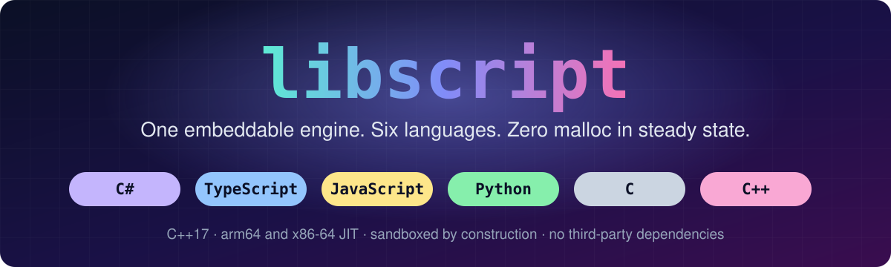
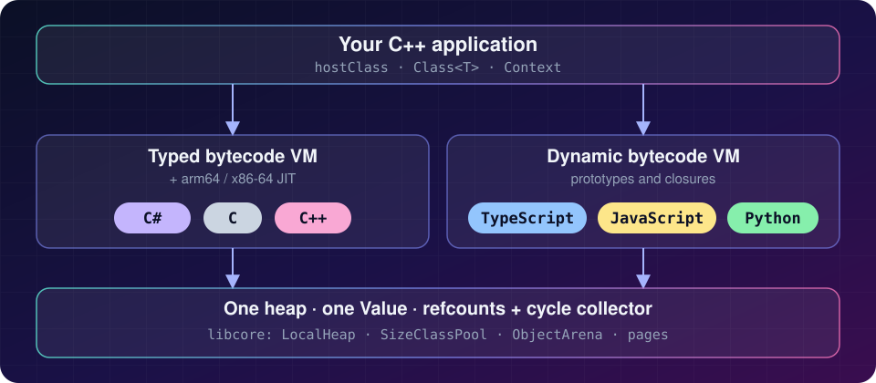

<p align="center">
  
</p>

<p align="center">
  <a href="https://github.com/philipp-orlov/libscript/actions/workflows/ci.yml"></a>
  <a href="LICENSE"></a>
  
  
  
  
  
</p>

<p align="center">
  <a href="#-against-javascriptcore"><b>vs JavaScriptCore</b></a> ·
  <a href="#-see-it-run"><b>See it run</b></a> ·
  <a href="#-six-languages-one-context"><b>Languages</b></a> ·
  <a href="#-why-it-holds-up"><b>Architecture</b></a> ·
  <a href="#-build-it"><b>Build it</b></a> ·
  <a href="#-documentation"><b>Docs</b></a>
</p>

<h3 align="center">Script your C++ application in the language your users already know.</h3>

<p align="center">
Bind a class once. <b>C#, TypeScript, JavaScript, Python, C and C++</b> can all call it:<br>
type-checked where the language has types, sandboxed in all of them, JIT-compiled,<br>
on a heap that looks the same after months of uptime. No .NET, no Node, no CPython.
</p>

<table>
<tr>
<td align="center" width="25%"><h2>1.5× faster</h2><b>to the first result</b><br>than JavaScriptCore.<br><sub>No warm-up tax: ahead on 36 of 41 workloads.</sub></td>
<td align="center" width="25%"><h2>4.7× less memory</h2><b>than JavaScriptCore</b>, at peak.<br><sub>Never above it on any workload,<br>and no growth over 1,000 iterations.</sub></td>
<td align="center" width="25%"><h2>0 mallocs</h2><b>in steady state</b>, in any language.<br><sub>Nothing to fragment.<br>A test holds it at exactly zero.</sub></td>
<td align="center" width="25%"><h2>7 MB</h2><b>the whole runner</b>, six languages.<br><sub>JavaScriptCore: 31 MB,<br>plus 37 MB of ICU.</sub></td>
</tr>
</table>

<sub>JetStream 3, the 41 JavaScript workloads that run in a plain shell, against JavaScriptCore 2.52.6 with all its tiers,
on arm64. Numbers and method are <a href="#-against-javascriptcore">below</a>.</sub>

## 🏁 Against JavaScriptCore

JavaScriptCore is the engine of Apple's Safari and of Bun, Anthropic's JavaScript runtime: four tiers, a concurrent
compiler, twenty years of tuning. libscript is a library you link into your application. On [JetStream 3](https://github.com/WebKit/JetStream):

| | libscript vs JSC | What it means |
| --- | :-: | --- |
| **First iteration** | **0.66×** the time | Scripts are fast from the first call. Ahead on 36 of 41 workloads. |
| **Later iterations** | 1.22× the time | Within a quarter of JSC's top tier, and ahead on 10 of 41. The gap closes with every release. |
| **Peak memory** | **0.21×** the size | A fifth of JSC's memory, as a geometric mean. Not above JSC on a single workload. |
| **Binary size** | **0.23×** the size | A 7.2 MB executable against a 30.9 MB library. With the ICU libraries that JSC loads: 0.11×. |

The 7.2 MB is the complete `libscript` runner, stripped: six language front ends, the interpreter, the JIT compilers
and the regular-expression compiler, linked statically. It needs only the C and C++ runtime libraries.

Memory is where the two designs part ways. JSC trades memory for speed and lets garbage wait for a collection.
libscript frees an object the moment it dies, so a script's footprint is what it holds and little more:

| Workload | libscript | JavaScriptCore | |
| --- | --: | --: | --: |
| `raytrace` | **13 MiB** | 314 MiB | 24× less |
| `js-tokens` | **10 MiB** | 197 MiB | 19× less |
| `ML` | **21 MiB** | 328 MiB | 16× less |
| `cdjs` | **20 MiB** | 239 MiB | 12× less |
| `regexp-octane` | **27 MiB** | 181 MiB | 7× less |
| `pdfjs` | **72 MiB** | 379 MiB | 5× less |
| `pdfjs`, 1,000 iterations | **396 MiB** | 1,246 MiB | 3× less |

And it stays there: over 300 and 1,000 iterations of every workload, the resident size after warm-up grows only where
the program itself keeps data.

Some workloads already run faster than in JSC at full speed: `crypto` 0.78×, `navier-stokes` 0.81×,
`stanford-crypto-aes` 0.81×, `proxy-mobx` 0.82×, `gbemu` 0.88×, `Basic` 0.90×, `pdfjs` 0.93×.

<sub>Measured on one core of a 20-core arm64 Linux machine (Cortex-X925), Release build, best of two interleaved rounds;
ratios are libscript's time or peak resident size over JSC's. Later iterations are the mean of iterations 2 to 15, so
they include JSC's own warm-up. The scripts are in <a href="tools/perf">tools/perf</a>; the full table and where the
time goes are in <a href="docs/vm-core.md">vm-core.md</a>.</sub>

## ⚡ See it run

```cpp
script::Context ctx;

// Bound once. Every language sees it, and the typed ones check calls against these C++ signatures.
ctx.hostClass("Host")
    .method("Count", [&] { return int(words.size()); })
    .method("Word", [&](int i) { return words.at(std::size_t(i)); })
    .method("Report", [](std::string who, std::string word, int n) { /* ... */ });

ctx.eval(R"(var seen = new Dictionary<string, int>(); /* ... */ Host.Report("C#", top, n);)", "top.cs");
ctx.eval(R"(const seen = new Map<string, number>();    /* ... */ Host.Report("TypeScript", w, n);)", "top.ts");
ctx.eval(R"(top = max(words, key=words.count);          # ...    Host.Report("Python", top, n))", "top.py");

// A wrong call never runs.
ctx.diagnose("Host.Report(\"x\", 42, 1);", "bad.ts");
// bad.ts(1): error: argument 2 type mismatch: '42' is not assignable to 'string'
```

One host API, one job, six languages, wrong calls rejected before they run. The complete program is
[examples/polyglot/word_count.cpp](examples/polyglot/word_count.cpp), built and runnable as it stands.

## 🌐 Six languages, one context

| Language | Runs on | What you get | Reference |
| --- | --- | --- | --- |
| **C#** | typed engine + JIT | static checking, reified generics, records, patterns, tuples, ranges | [csharp.md](docs/languages/csharp.md) |
| **TypeScript** | vm core + JIT | a structural type checker, then erased; generics, narrowing, `strict` mode | [typescript.md](docs/languages/typescript.md) |
| **JavaScript** | vm core + JIT | ES2024 and more: classes, generators, async, regular expressions, `BigInt`, typed arrays, `Proxy`, `WeakMap`; 79% of test262 | [javascript.md](docs/languages/javascript.md) |
| **Python** | vm core + JIT | the everyday core of Python 3: functions, classes, dicts, lambdas | [python.md](docs/languages/python.md) |
| **C** | typed engine + JIT | a sandboxed C with a `libc` of natives; no ambient file or OS access | [c.md](docs/languages/c.md) |
| **C++** | typed engine + JIT | classes, virtual dispatch, exceptions, the standard containers | [cpp.md](docs/languages/cpp.md) |

Every language is a CMake option. Turn off what you do not ship, and its front end, tests and examples go with it.

## ✨ Why it holds up

The numbers above come from the design, not from tuning one benchmark.

<table>
<tr>
<td width="50%" valign="top">

### 🧠 Memory that stays put
Objects are counted, so most garbage is freed the moment it dies, not at the next collection. Short-lived objects
skip even the counting: they are born young and swept in bulk. Nothing ever moves, so C++ can hold a pointer to any
object. A cycle collector handles the rest. Once warm, a program **makes no call to `malloc`**, and
[a test](tests/core/test_steady_state.cpp) holds that at zero. [More](docs/memory.md)

</td>
<td width="50%" valign="top">

### 🏎️ Three tiers, no waiting
An interpreter that starts at once, a baseline compiler after 200 calls, and an optimizing compiler with an SSA graph,
type speculation, inlining and a register allocator. Each tier hands a running function to the next in the middle of
a loop. That is why the first iteration beats JSC: there is no slow start to pay for. [More](docs/vm-core.md)

</td>
</tr>
<tr>
<td valign="top">

### 🔗 One binding layer
`hostClass` and `Class<T>` declare a member once. The C# compiler and the TypeScript checker check calls against the
C++ signature, and the dynamic languages see the same functions on the same objects. `script::Value` is the same
16-byte value whichever language made it. [More](docs/embedding.md)

</td>
<td valign="top">

### 🛡️ A sandbox by construction
No file system, no network, no reflection, and no `eval` unless the host turns it on. A script reaches exactly what
the host hands it. `memoryLimit`, `stackLimit` and an interrupt hook bound what it can spend, across every language
in the context at once.

</td>
</tr>
<tr>
<td valign="top">

### 📦 Compile once, run anywhere
`compile` produces an `Assembly` that runs as often as you like without parsing again. A C# assembly serializes to a
portable image that another process loads without lexing, parsing or checking. [More](docs/compilation.md)

</td>
<td valign="top">

### 🧪 Tested as if it had to last
53 test suites in 21 engine configurations, AddressSanitizer, UndefinedBehaviorSanitizer and ThreadSanitizer, test262,
differential fuzzers that hold compiled code to the interpreter, and soak tests that watch the resident size. Known
gaps are written down in [limitations.md](docs/limitations.md).

</td>
</tr>
</table>

Built for months of uptime: four contexts on four threads churning objects in JavaScript, Python and C#, and compiling
new programs in every language throughout, for 25 minutes and 15.2 million iterations. Resident size: 67.2 MiB in the
middle third of the run, 68.8 MiB in the last, with a fitted trend that points slightly down.

## 🔬 Under the hood

<p align="center">
  
</p>

Two engines share one heap. C#, C and C++ compile to typed bytecode with arm64 and x86-64 back ends. TypeScript,
JavaScript and Python run on the vm core: NaN-boxed values, shapes and inline caches, a register interpreter and two
compilers. The optimizing tier is tuned on arm64 Linux; x86-64 runs the baseline tier and an earlier optimizer, and
other platforms interpret. The one dependency is [libcore](https://github.com/philipp-orlov/libcore).

## 🔧 Build it

```bash
git clone https://github.com/philipp-orlov/libcore
git clone https://github.com/philipp-orlov/libscript
cmake -S libscript -B build -DCMAKE_BUILD_TYPE=Release
cmake --build build -j
ctest --test-dir build --output-on-failure
```

Use it from your own project, with the two checkouts side by side:

```cmake
add_subdirectory(libscript)
target_link_libraries(my_app PRIVATE script::script)
```

Or install both and use `find_package(script REQUIRED)`.

<details>
<summary><b>All build options</b></summary>

| Option | Default | Effect |
| --- | --- | --- |
| `SCRIPT_LANG_CSHARP` | ON | the C# front end and the typed engine |
| `SCRIPT_LANG_TYPESCRIPT` | ON | the TypeScript front end and the vm core |
| `SCRIPT_LANG_JAVASCRIPT` | ON | the JavaScript front end and the vm core |
| `SCRIPT_LANG_PYTHON` | ON | the Python front end and the vm core |
| `SCRIPT_LANG_C` | ON | the C front end and the typed engine |
| `SCRIPT_LANG_CPP` | ON | the C++ dialect of the C front end and the typed engine |
| `SCRIPT_ENABLE_JIT` | ON | the arm64 and x86-64 code generators of the typed engine |
| `SCRIPT_JS_CORE` | `vm` | what runs JavaScript, TypeScript and Python: `vm` (the vm core, with the old dynamic engine built beside it as the oracle), `both` (the same), or `dyn` (the old engine only) |
| `SCRIPT_JIT_THREAD` | ON | the dynamic engine: a large function compiles on a thread of its own while it is interpreted |
| `SCRIPT_UNICODE_PROPERTIES` | ON (OFF in Compact) | the 43 KB of tables behind `\p{...}` in regular expressions |
| `SCRIPT_BUILD_TESTS` | ON | the test suites, one executable per suite |
| `SCRIPT_BUILD_EXAMPLES` | ON | the examples |
| `SCRIPT_BUILD_TOOLS` | ON | the `libscript` command line |
| `SCRIPT_BUILD_BENCHMARKS` | OFF | `bench/`: cost per round, and the long soak |
| `SCRIPT_LIBCORE_DIR` | `../libcore` | a libcore checkout; empty: `find_package(libcore)` |
| `SCRIPT_BUILD_SHARED` | OFF | a shared library instead of a static one |
| `SCRIPT_ENABLE_ASAN` | OFF | address and undefined-behaviour sanitizers |
| `SCRIPT_WARNINGS_AS_ERRORS` | OFF | `-Werror` / `/WX` |

An engine is built only when a language needs it: turning off C#, C and C++ drops the typed engine and its JIT, turning
off TypeScript, JavaScript and Python drops the vm core and the dynamic engine. C and C++ share one front end, so either brings it. At
least one language must stay on. The generated `script/config.hpp` tells the embedder what the build contains, and
`script::supported(Language)` says the same at run time.

</details>

## 💻 The command line

```
$ libscript program.cs                  # run a file; the extension picks the language (.cs .ts .js .py .c .cpp)
$ libscript rules.ts --strict           # TypeScript with strictNullChecks and noImplicitAny
$ libscript --lang js -e '6 * 7'        # run a snippet
$ libscript --lang py                   # a REPL for js, ts or py
$ libscript --check program.cs          # compile only, report diagnostics
$ libscript -c program.sxa program.cs   # compile C#, C or C++ to an assembly image; -r runs one
$ libscript --stats program.js          # heap and code statistics when it ends
$ libscript --stack 256 --memory 64 program.js
```

A JavaScript program run by the tool also gets what a shell such as `jsc` or `d8` offers (`print`, `read`, `load`,
`setTimeout`, `gc` and the like). Those belong to the tool: an embedding gives a script only what its host binds.

## 🎯 Examples

Every example is one file and one executable. Start with
[polyglot/shared_host.cpp](examples/polyglot/shared_host.cpp), or the `quickstart` of your language.

<details>
<summary><b>All examples</b></summary>

| File | What it shows |
| --- | --- |
| [examples/csharp/quickstart.cpp](examples/csharp/quickstart.cpp) | evaluate, compile, call, and read the errors |
| [examples/csharp/bindings.cpp](examples/csharp/bindings.cpp) | host functions, a wrapped C++ class, delegates in both directions |
| [examples/csharp/sandbox.cpp](examples/csharp/sandbox.cpp) | limits, timeouts, and what untrusted code cannot reach |
| [examples/csharp/compile.cpp](examples/csharp/compile.cpp) | compile on the build machine, ship the image, load on the device |
| [examples/csharp/plugin.cpp](examples/csharp/plugin.cpp) | a plugin system around a C# interface |
| [examples/csharp/modules.cpp](examples/csharp/modules.cpp) | a program split across source files, compiled as separate units |
| [examples/csharp/native.cpp](examples/csharp/native.cpp) | interpreted against compiled, measured, on the same programs |
| [examples/csharp/longrun.cpp](examples/csharp/longrun.cpp) | thousands of allocation-heavy rounds, and a heap that does not grow |
| [examples/csharp/modern.cpp](examples/csharp/modern.cpp) | records, patterns, tuples, ranges and the rest of the syntax after C# 6 |
| [examples/typescript/quickstart.cpp](examples/typescript/quickstart.cpp) | run a script, read a result, expose a function |
| [examples/typescript/bindings.cpp](examples/typescript/bindings.cpp) | classes, instances, ownership, callbacks |
| [examples/typescript/sandbox.cpp](examples/typescript/sandbox.cpp) | no host access, a memory ceiling, a time limit |
| [examples/typescript/config.cpp](examples/typescript/config.cpp) | TypeScript as a configuration language, checked before it runs |
| [examples/typescript/plugin.cpp](examples/typescript/plugin.cpp) | scripts register handlers, the application dispatches events |
| [examples/javascript/quickstart.cpp](examples/javascript/quickstart.cpp) | run a script, read a result, expose a function |
| [examples/javascript/bindings.cpp](examples/javascript/bindings.cpp) | classes, instances, ownership, callbacks |
| [examples/javascript/sandbox.cpp](examples/javascript/sandbox.cpp) | no host access, a memory ceiling, a time limit |
| [examples/javascript/config.cpp](examples/javascript/config.cpp) | JavaScript as a configuration language |
| [examples/javascript/plugin.cpp](examples/javascript/plugin.cpp) | scripts register handlers, the application dispatches events |
| [examples/python/quickstart.cpp](examples/python/quickstart.cpp) | run a script, read a result, expose a function and a class, call back |
| [examples/python/bindings.cpp](examples/python/bindings.cpp) | classes, instances, a borrowed host service, exceptions both ways |
| [examples/python/sandbox.cpp](examples/python/sandbox.cpp) | no host access, a memory ceiling, a time limit, cancellation |
| [examples/python/config.cpp](examples/python/config.cpp) | Python as a configuration language, read back into C++ structs |
| [examples/python/plugin.cpp](examples/python/plugin.cpp) | scripts register handlers, the application dispatches events |
| [examples/c/quickstart.cpp](examples/c/quickstart.cpp) | run a program, a host class, compile once and run many |
| [examples/c/bindings.cpp](examples/c/bindings.cpp) | host functions and a wrapped C++ class seen from C, arrays across the boundary |
| [examples/c/sandbox.cpp](examples/c/sandbox.cpp) | what a C program cannot reach, and the limits that stop it |
| [examples/c/compile.cpp](examples/c/compile.cpp) | compile C on the build machine, ship the image, load and run it elsewhere |
| [examples/cpp/quickstart.cpp](examples/cpp/quickstart.cpp) | classes, containers, streams and exceptions in five minutes |
| [examples/cpp/classes.cpp](examples/cpp/classes.cpp) | a class hierarchy with virtual dispatch, scripted against a host contract |
| [examples/cpp/bindings.cpp](examples/cpp/bindings.cpp) | a wrapped C++ class, a borrowed host service, `std::vector` both ways |
| [examples/cpp/sandbox.cpp](examples/cpp/sandbox.cpp) | limits, timeouts, exceptions crossing the boundary, no ambient authority |
| [examples/polyglot/word_count.cpp](examples/polyglot/word_count.cpp) | the example at the top of this page: one host API, one job in all six languages, wrong calls rejected at compile time |
| [examples/polyglot/shared_host.cpp](examples/polyglot/shared_host.cpp) | one Context, six languages, one set of host bindings; type errors caught in the typed languages; one C++ instance shared by all |
| [examples/polyglot/rules_engine.cpp](examples/polyglot/rules_engine.cpp) | rules in six languages compiled once and run 120,000 times against host events, with a heap that stays put |

The `polyglot/` examples are built only when every language is on.

</details>

## 📚 Documentation

| Read this | For |
| --- | --- |
| [design.md](docs/design.md) | the core, the engines, the front ends, and why the split is where it is |
| [vm-core.md](docs/vm-core.md) | the vm core: its tiers, its heap, and its standing against JavaScriptCore |
| [embedding.md](docs/embedding.md) | the C++ API |
| [languages/](docs/languages/) | what each language and its library support |
| [compilation.md](docs/compilation.md) | assemblies, units and the image format |
| [jit.md](docs/jit.md) | the typed engine's arm64 and x86-64 back ends |
| [memory.md](docs/memory.md) | the heap, the collector, and what a long run costs |
| [limitations.md](docs/limitations.md) | what is not there, stated plainly |
| [adding-a-language.md](docs/adding-a-language.md) | the hook a new front end plugs into |

## 📄 License

[Apache License 2.0](LICENSE). Copyright (c) 2026 Philipp Orlov. See [NOTICE](NOTICE).
