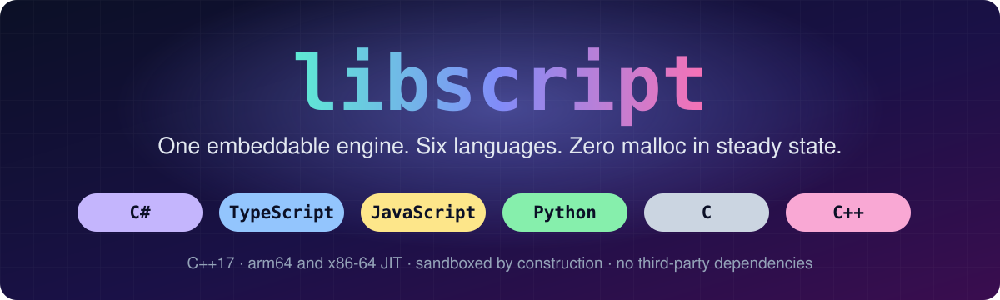
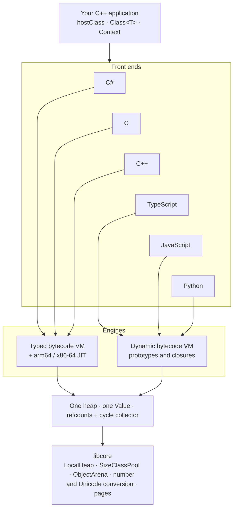

<p align="center">
  
</p>

<p align="center">
  <a href="https://github.com/philipp-orlov/libscript/actions/workflows/ci.yml"></a>
  <a href="LICENSE"></a>
  
  
  
  
</p>

<p align="center">
  <a href="#-see-it-run"><b>See it run</b></a> ·
  <a href="#-the-numbers"><b>The numbers</b></a> ·
  <a href="#-under-the-hood"><b>Under the hood</b></a> ·
  <a href="#-build-it"><b>Build it</b></a> ·
  <a href="#-examples"><b>Examples</b></a> ·
  <a href="#-documentation"><b>Docs</b></a>
</p>

**Your C++ application, scriptable in the language your users already know.** Bind a class once and C#, TypeScript,
JavaScript, Python, C and C++ can all call it, type-checked where the language has types, sandboxed in all of them,
and on a heap built to still look the same after months of uptime. No .NET, no Node, no CPython.

## ⚡ See it run

```cpp
#include "script/script.hpp"

int main()
{
    script::Context ctx;

    // One binding. Every language sees it.
    ctx.hostClass("Env").method("Greet", [](std::string name) { return "hello " + name; });

    std::puts(ctx.eval("return Env.Greet(\"world\").ToUpper();", "hello.cs").toString().c_str());
    std::puts(ctx.eval("Env.Greet('world').toUpperCase()", "hello.ts").toString().c_str());
    std::puts(ctx.eval("Env.Greet('world').toUpperCase()", "hello.js").toString().c_str());
    std::puts(ctx.eval("Env.Greet('world').upper()", "hello.py").toString().c_str());
    ctx.eval("#include <stdio.h>\nint main() { puts(Env.Greet(\"world\")); return 0; }", "hello.c");

    // Caught before anything runs: Greet takes a string, and the checkers know it from the C++ signature.
    for (const script::Diagnostic& d : ctx.diagnose("Env.Greet(42);", "bad.cs"))
        std::puts(d.toString().c_str());
    for (const script::Diagnostic& d : ctx.diagnose("Env.Greet(42)", "bad.ts"))
        std::puts(d.toString().c_str());
}
```

```text
HELLO WORLD
HELLO WORLD
HELLO WORLD
HELLO WORLD
hello world
bad.cs(1,11): error CS29: cannot implicitly convert 'int' to 'string'
bad.ts(1): error: argument 1 type mismatch: '42' is not assignable to 'string'
```

## 🌐 Six languages, one context

| Language | Runs on | What you get | Reference |
| --- | --- | --- | --- |
| **C#** | typed engine + JIT | static checking, reified generics, records, patterns, tuples, ranges | [csharp.md](docs/languages/csharp.md) |
| **TypeScript** | dynamic engine | a structural type checker, then erased; generics, narrowing, `strict` mode | [typescript.md](docs/languages/typescript.md) |
| **JavaScript** | dynamic engine | prototypes, closures, classes, promises, `Map`/`Set`, JSON | [javascript.md](docs/languages/javascript.md) |
| **Python** | dynamic engine | the everyday core of Python 3: functions, classes, dicts, lambdas | [python.md](docs/languages/python.md) |
| **C** | typed engine + JIT | a sandboxed C with a `libc` of natives; no ambient file or OS access | [c.md](docs/languages/c.md) |
| **C++** | typed engine + JIT | classes, virtual dispatch, exceptions, the standard containers | [cpp.md](docs/languages/cpp.md) |

Every language is a CMake option. Turn off what you don't ship, and its front end, tests and examples go with it; an
engine goes once no language needs it.

## 🚀 The numbers

| Workload (per round) | Before libcore | Now | Speed | Heap calls per round |
| --- | --: | --: | --: | --- |
| JavaScript: objects, closures, `Map`, JSON | 587 µs | **275 µs** | **2.1×** | 3,115 → **0** |
| Python: dicts, lists, lambdas | 863 µs | **600 µs** | **1.4×** | 8,288 → **0** |
| C#: classes, `List`, `Dictionary`, `StringBuilder` | 203 µs | **157 µs** | **1.3×** | 2,274 → **0** |
| Long strings: build and join 1,000 | 619 µs | **180 µs** | **3.4×** | 5,027 → **0** |
| Number to string, 1,000 times | 863 µs | **134 µs** | **6.4×** | 0 → **0** |

And over time: four contexts on four threads churning objects in JavaScript, Python and C#, with bursts, and compiling new programs in every language throughout:

| 25-minute soak | |
| --- | --- |
| Iterations | 15.2 million |
| Resident size, median of the middle third of the run | 67.2 MiB |
| Resident size, median of the last third | 68.8 MiB (+2.4 %) |
| Fitted trend | slightly downward |

<sub>Measured on one 20-core arm64 Linux machine with GCC 13 in a Release build; compare the ratios, not the absolute
times. The benchmark's own argument vector is left out of the heap calls. Reproduce with
<code>-DSCRIPT_BUILD_BENCHMARKS=ON</code>, <code>bench_longrun</code> and
<code>SCRIPT_SOAK_SECONDS=1500 bench_soak_mixed</code>.</sub>

## ✨ Why it holds up

<table>
<tr>
<td width="50%" valign="top">

### 🧠 Memory that stays put
Reference counting frees most objects the moment they die, and one cycle collector handles the rest, in time
proportional to the live set. Once warmed up, a running program **makes no call to `malloc`, in any language**, so the
general allocator has nothing to fragment. [A test](tests/core/test_steady_state.cpp) holds that at exactly zero.
[More](docs/memory.md)

</td>
<td width="50%" valign="top">

### 🔗 One binding layer
`hostClass` and `Class<T>` declare a member once. The C# compiler and the TypeScript checker check calls against the
C++ signature, and the dynamic languages see the same functions on the same objects. `script::Value` is the same
16-byte tagged value whichever language made it. [More](docs/embedding.md)

</td>
</tr>
<tr>
<td valign="top">

### 🏎️ Two machines, one heap
C#, C and C++ compile to typed bytecode, with arm64 and x86-64 back ends around 10× faster than interpreting for the
arithmetic-and-loops core of a method. TypeScript, JavaScript and Python run on a prototype-based stack machine.
[More](docs/design.md)

</td>
<td valign="top">

### 🛡️ A sandbox by construction
No file system, no network, no reflection, no `eval` from inside a script. A program reaches exactly what the host
hands it, while `memoryLimit`, `stackLimit` and an interrupt hook bound what it can spend, across every language in the
context at once.

</td>
</tr>
<tr>
<td valign="top">

### 📦 Compile once, run anywhere
`compile` produces an `Assembly` that runs as often as you like without parsing again. A C# assembly serializes to a
portable image another process loads without lexing, parsing or checking. [More](docs/compilation.md)

</td>
<td valign="top">

### 🧪 Tested as if it had to last
42 test suites across the languages, all of them under AddressSanitizer and UndefinedBehaviorSanitizer, the ones that
share state under ThreadSanitizer, with long-run soak tests that check the resident size. CI runs both code generators on their own hardware. Known gaps are
written down in [limitations.md](docs/limitations.md).

</td>
</tr>
</table>

## 🔬 Under the hood



The machinery under the languages comes from [libcore](https://github.com/philipp-orlov/libcore), the foundation shared
with libsql, librpc and the rest of the family, so none of it is written here a second time.

## 🔧 Build it

```bash
git clone https://github.com/philipp-orlov/libcore
git clone https://github.com/philipp-orlov/libscript
cmake -S libscript -B build -DCMAKE_BUILD_TYPE=Release
cmake --build build -j
ctest --test-dir build --output-on-failure
```

Use it from your own project, with the two checkouts side by side:

```cmake
add_subdirectory(libscript)
target_link_libraries(my_app PRIVATE script::script)
```

Or install both and use the package:

```cmake
find_package(script REQUIRED)     # finds libcore as well
target_link_libraries(my_app PRIVATE script::script)
```

<details>
<summary><b>All build options</b></summary>

| Option | Default | Effect |
| --- | --- | --- |
| `SCRIPT_LANG_CSHARP` | ON | the C# front end and the typed engine |
| `SCRIPT_LANG_TYPESCRIPT` | ON | the TypeScript front end and the dynamic engine |
| `SCRIPT_LANG_JAVASCRIPT` | ON | the JavaScript front end and the dynamic engine |
| `SCRIPT_LANG_PYTHON` | ON | the Python front end and the dynamic engine |
| `SCRIPT_LANG_C` | ON | the C front end and the typed engine |
| `SCRIPT_LANG_CPP` | ON | the C++ dialect of the C front end and the typed engine |
| `SCRIPT_ENABLE_JIT` | ON | the arm64 and x86-64 code generators (needs the typed engine) |
| `SCRIPT_BUILD_TESTS` | ON | the test suites, one executable per suite |
| `SCRIPT_BUILD_EXAMPLES` | ON | the examples |
| `SCRIPT_BUILD_TOOLS` | ON | the `libscript` command line |
| `SCRIPT_BUILD_BENCHMARKS` | OFF | `bench/`: cost per round, and the long soak |
| `SCRIPT_LIBCORE_DIR` | `../libcore` | a libcore checkout; empty: `find_package(libcore)` |
| `SCRIPT_BUILD_SHARED` | OFF | a shared library instead of a static one |
| `SCRIPT_ENABLE_ASAN` | OFF | address and undefined-behaviour sanitizers |
| `SCRIPT_WARNINGS_AS_ERRORS` | OFF | `-Werror` / `/WX` |

An engine is built only when a language needs it: turning off C#, C and C++ drops the typed engine and the JIT, turning
off TypeScript, JavaScript and Python drops the dynamic engine. C and C++ share one front end, so either brings it. At
least one language must stay on. The generated `script/config.hpp` tells the embedder what the build contains, and
`script::supported(Language)` says the same at run time.

</details>

## 💻 The command line

```
$ libscript program.cs                  # run a file; the extension picks the language
$ libscript script.py                   # .py, .c, .cpp, .ts, .js all work the same way
$ libscript rules.ts --strict           # TypeScript with strictNullChecks and noImplicitAny
$ libscript --lang js -e '6 * 7'        # run a snippet
$ libscript --lang py -e 'print(6 * 7)'
$ libscript --lang js                   # a REPL for a dynamic language (js, ts, py; one line at a time)
$ libscript --check program.cs          # compile only, report diagnostics
$ libscript -c program.sxa program.cs   # compile C#, C or C++ to an assembly image
$ libscript -r program.sxa              # run an image
$ libscript --dump program.cs           # disassemble every method of a C# assembly
$ libscript --stats program.js          # heap and code statistics when it ends
$ libscript --native program.cs         # C#: compile to machine code up front
$ libscript --jit program.cs            # C#: compile methods once they get hot
$ libscript --stack 256 --memory 64 program.js
```

## 🎯 Examples

Every example is one file and one executable. Start with
[polyglot/shared_host.cpp](examples/polyglot/shared_host.cpp), or the `quickstart` of your language.

<details>
<summary><b>All examples</b></summary>

| File | What it shows |
| --- | --- |
| [examples/csharp/quickstart.cpp](examples/csharp/quickstart.cpp) | evaluate, compile, call, and read the errors |
| [examples/csharp/bindings.cpp](examples/csharp/bindings.cpp) | host functions, a wrapped C++ class, delegates in both directions |
| [examples/csharp/sandbox.cpp](examples/csharp/sandbox.cpp) | limits, timeouts, and what untrusted code cannot reach |
| [examples/csharp/compile.cpp](examples/csharp/compile.cpp) | compile on the build machine, ship the image, load on the device |
| [examples/csharp/plugin.cpp](examples/csharp/plugin.cpp) | a plugin system around a C# interface |
| [examples/csharp/modules.cpp](examples/csharp/modules.cpp) | a program split across source files, compiled as separate units |
| [examples/csharp/native.cpp](examples/csharp/native.cpp) | interpreted against compiled, measured, on the same programs |
| [examples/csharp/longrun.cpp](examples/csharp/longrun.cpp) | thousands of allocation-heavy rounds, and a heap that does not grow |
| [examples/csharp/modern.cpp](examples/csharp/modern.cpp) | records, patterns, tuples, ranges and the rest of the syntax after C# 6 |
| [examples/typescript/quickstart.cpp](examples/typescript/quickstart.cpp) | run a script, read a result, expose a function |
| [examples/typescript/bindings.cpp](examples/typescript/bindings.cpp) | classes, instances, ownership, callbacks |
| [examples/typescript/sandbox.cpp](examples/typescript/sandbox.cpp) | no host access, a memory ceiling, a time limit |
| [examples/typescript/config.cpp](examples/typescript/config.cpp) | TypeScript as a configuration language, checked before it runs |
| [examples/typescript/plugin.cpp](examples/typescript/plugin.cpp) | scripts register handlers, the application dispatches events |
| [examples/javascript/quickstart.cpp](examples/javascript/quickstart.cpp) | run a script, read a result, expose a function |
| [examples/javascript/bindings.cpp](examples/javascript/bindings.cpp) | classes, instances, ownership, callbacks |
| [examples/javascript/sandbox.cpp](examples/javascript/sandbox.cpp) | no host access, a memory ceiling, a time limit |
| [examples/javascript/config.cpp](examples/javascript/config.cpp) | JavaScript as a configuration language |
| [examples/javascript/plugin.cpp](examples/javascript/plugin.cpp) | scripts register handlers, the application dispatches events |
| [examples/python/quickstart.cpp](examples/python/quickstart.cpp) | run a script, read a result, expose a function and a class, call back |
| [examples/python/bindings.cpp](examples/python/bindings.cpp) | classes, instances, a borrowed host service, exceptions both ways |
| [examples/python/sandbox.cpp](examples/python/sandbox.cpp) | no host access, a memory ceiling, a time limit, cancellation |
| [examples/python/config.cpp](examples/python/config.cpp) | Python as a configuration language, read back into C++ structs |
| [examples/python/plugin.cpp](examples/python/plugin.cpp) | scripts register handlers, the application dispatches events |
| [examples/c/quickstart.cpp](examples/c/quickstart.cpp) | run a program, a host class, compile once and run many |
| [examples/c/bindings.cpp](examples/c/bindings.cpp) | host functions and a wrapped C++ class seen from C, arrays across the boundary |
| [examples/c/sandbox.cpp](examples/c/sandbox.cpp) | what a C program cannot reach, and the limits that stop it |
| [examples/c/compile.cpp](examples/c/compile.cpp) | compile C on the build machine, ship the image, load and run it elsewhere |
| [examples/cpp/quickstart.cpp](examples/cpp/quickstart.cpp) | classes, containers, streams and exceptions in five minutes |
| [examples/cpp/classes.cpp](examples/cpp/classes.cpp) | a class hierarchy with virtual dispatch, scripted against a host contract |
| [examples/cpp/bindings.cpp](examples/cpp/bindings.cpp) | a wrapped C++ class, a borrowed host service, `std::vector` both ways |
| [examples/cpp/sandbox.cpp](examples/cpp/sandbox.cpp) | limits, timeouts, exceptions crossing the boundary, no ambient authority |
| [examples/polyglot/shared_host.cpp](examples/polyglot/shared_host.cpp) | one Context, six languages, one set of host bindings; type errors caught in the typed languages; one C++ instance shared by all |
| [examples/polyglot/rules_engine.cpp](examples/polyglot/rules_engine.cpp) | rules in six languages compiled once and run 120,000 times against host events, with a heap that stays put |

The `polyglot/` examples are built only when every language is on.

</details>

## 📚 Documentation

| Read this | For |
| --- | --- |
| [design.md](docs/design.md) | the core, the two engines, the front ends, and why the split is where it is |
| [embedding.md](docs/embedding.md) | the C++ API |
| [languages/](docs/languages/) | what each language and its library support |
| [compilation.md](docs/compilation.md) | assemblies, units and the image format |
| [jit.md](docs/jit.md) | the arm64 and x86-64 back ends |
| [memory.md](docs/memory.md) | the heap, the collector, and what a long run costs |
| [limitations.md](docs/limitations.md) | what is not there, stated plainly |
| [adding-a-language.md](docs/adding-a-language.md) | the hook a new front end plugs into |

## 📄 License

[Apache License 2.0](LICENSE). Copyright (c) 2026 Philipp Orlov. See [NOTICE](NOTICE).
